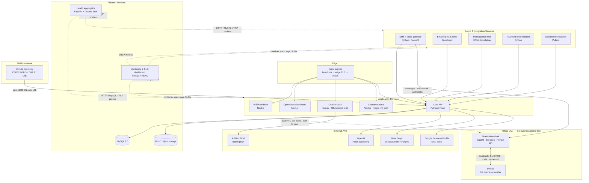

# Anatomy of a Solo-Operated Production Microservice Platform

**Robert Davis** — CEO, CTO, and Principal Architect

**A solo-built, solo-operated microservices platform running a real business in production since 2023.** *Revised November 9, 2026.*

**▶ The primary, typeset version of this document — research-paper style, with figures — is served at [rahb3rt.github.io/platform-architecture](https://rahb3rt.github.io/platform-architecture/). This README is the plain-markdown mirror.**

This document describes the architecture of a production platform I designed, built, and operate end-to-end: 15 services plus embedded vehicle hardware, with CI/CD, health-gated releases with automatic rollback, observability, SLO tracking, and multi-environment deployment behind a self-service control plane. The application code is proprietary (it runs my company); this repo documents the engineering.

**By the numbers:** 15 services · 17,000+ jobs scheduled · 5,200+ invoices processed · 100,000+ vehicle telemetry readings · hourly per-tenant backups · 1 operator. Counts are `SELECT COUNT(*)` aggregates from the production database.

---

## System Topology



## Service Inventory

| Service | Role | Stack |
|---|---|---|
| Core API | Business logic — 80 route domains, 716 endpoints | Python, Flask, MySQL |
| Public website | Customer-facing site | Next.js |
| Operations dashboard | Internal operations app | Next.js |
| Kiosk | Crew timeclock and field app — offline-first, server-side sessions, native push | Next.js 15 / React 19, Capacitor iOS/Android shell |
| Customer portal | Balance, invoices, next visit, service requests | Next.js 15, passwordless magic-link auth |
| SMS + voice | Telephony gateway — the only service that talks to the phone-line Macs: texting with iMessage→SMS fallback, call control, voicemail, recordings | Python, FastAPI |
| Phone line (BlueBubbles fork) | iMessage/SMS server and call bridge on an office Mac paired with the business iPhone | TypeScript, Electron, injected Private API helpers |
| Email / Mail | Inbox sync and cache; quote, invoice and contract mail from DB-stored templates | Node, HTML templating |
| Payment reconciliation | Matches external payments to invoices | Python |
| Document extraction | Parses inbound documents into structured data | Python |
| Health aggregator | Fleet-wide health checks with auto-discovery | Python, FastAPI, Docker SDK |
| Monitoring dashboard | Container metrics, logs, alerting, SLO tracking | Next.js, RBAC |
| Vehicle telemetry | OBD-II + GPS collection from field vehicles | C++ / ESP32 / PlatformIO |
| nginx | Three-tier ingress: PROXY-protocol front, TLS edge, reload-only router | nginx:alpine |
| MySQL, MinIO | Persistence and object storage | Managed as containers |

## Core API Surface

The core API is a Flask monolith-by-choice: **80 route domains, 716 endpoints**, one deployable, every route documented in a generated Swagger spec.

| Area | Capabilities |
|---|---|
| Billing | invoicing, payments, payment methods, statements, customer credit, expenses, group/neighborhood billing, multi-invoice payment requests, collections |
| Quotes & pricing | per-service pricing models fitted on job costs and calibrated per town, AI-drafted quote lines grounded in the job book, approval that creates the contract and starts recurring service, open tracking |
| Contracts | templates, versioning (a sent contract is superseded, never rewritten), AI-drafted contract HTML, e-signing, audit trail |
| CRM & GIS | customers, properties, leads, requests, sites; AI site maps (aerial imagery + parcel and building geometry + vision segmentation, billable area derived from geometry, not trusted from the model) |
| Workforce | employees, teams, geofenced timeclock (both punch directions), timecards with punch-linked integrity, PTO charged through timecards and payroll, payroll review, crew announcements |
| Operations | jobs, scheduling, calendar, route optimization, mowing, plowing plans, service plans |
| Communications | messaging, voice (calls, voicemail, diarised transcripts), notifications, marketing campaigns, AI chat summaries and reply drafts, AI Q&A over conversation history, AI social publishing and a spreadsheet-style content plan |
| Field & assets | vehicle telemetry, Fleet Live (per-day paths, stops, engine data), canary firmware rollouts, tracker-assignment history, assets, access devices, weather |
| Platform | auth, RBAC roles, hashed API keys, audited admin impersonation, login audit, orgs, dashboards, reports, natural-language-to-SQL insights, webhook deliveries |

## AI-Assisted Publishing (closed loop)

The social subsystem is a small production case study in operating an LLM feature end-to-end:

- **Vision captioning with structured outputs.** Each photo is captioned by a vision call constrained to a JSON schema (title / caption / hashtags), with the caption contract — contact line placement, hashtag count and casing — enforced in code rather than trusted to the model.
- **Style rotation, measured.** Captions commit to one of a set of rotating engagement "angles"; every generated caption records which angle produced it. Publishing stores the resulting platform post ids, and an insights endpoint batch-fetches engagement from the Graph API and rolls it up **per angle** — so the prompt styles are judged by results, not vibes.
- **Prompts are data.** All prompts, style lists, and posting parameters live in a settings table (system defaults seeded and refreshed from code, owner overrides stored beside them). Tuning the voice never requires a deploy.
- **Server-enforced scheduling constraints.** One post per business-timezone calendar day, enforced at create/update and inside the autopilot allocator — conflicts slide forward and the API's response says why the date moved.
- **Rate-limit-aware caching.** Third-party feeds are layered: browser persistence paints instantly, a server-side TTL cache absorbs passive traffic, and an explicit refresh is the only real upstream fetch — with a floor so even button-mashing can't burn the API quota.
- **Failure surfacing.** Publish failures, OAuth tokens flipped to needs-reconnect *before* expiry, and new-comment deltas all flow into the app's notification stream via an event table — piggybacked on the publisher's existing cadence, costing no extra polling.
- **Media normalization at the door.** Phone uploads (HEIC/AVIF) are decoded — WASM for the patent-encumbered codec — and re-encoded to platform-safe JPEG at upload; serving goes through on-the-fly WebP thumbnails with immutable cache headers.

## Messaging and Voice: an iPhone as the Carrier

The business's phone number is a real iPhone, and it stays that way. Instead of porting the number to a cloud telephony provider, texting **and calling** run through that iPhone via an office Mac running my maintained fork of [BlueBubbles](https://github.com/BlueBubblesApp/bluebubbles-server) (an open-source macOS iMessage server). Customers keep texting and calling the number they have always had, iMessage threads keep working, and the operations app gets a full phone: inbox, softphone, call history, voicemail, recordings and transcripts.

```
browser (operations app) ──HTTPS/WSS──▶ telephony gateway (/v1/phone/*) ──HTTP, LAN──▶ BlueBubbles on a Mac ◀──Continuity──▶ iPhone
          │                                     │                                         (one Mac per phone line)
          └──────── WebRTC call audio, peer to peer ──────────────────────────────────────▶ Mac
                                                └──▶ core API (messages, call events, recordings) · MinIO (attachments, audio)
```

**The gateway.** The SMS service is the only component that talks to the Macs. It relays messages both ways, keeps the BlueBubbles credentials server-side, verifies the operations app's JWT and its `message:write` permission on every phone call, pushes live call status over a WebSocket, and carries recordings and transcripts off the Mac into object storage and the CRM — with a reconciler that replays any the CRM missed. A *line* is one Mac plus one iPhone number; adding a line is configuration. Call audio never passes through the gateway: it only brokers the WebRTC offer/answer, then browser and Mac stream directly.

**Texting.** Inbound messages arrive as webhooks, are normalized, have their attachments fetched by GUID into MinIO, and are forwarded to the CRM. Outbound sends are deliberately narrow — one in-flight request, a small keep-alive pool with a background probe, and a circuit breaker that fast-fails new sends for 45 s after two consecutive connect failures, so a sleeping Mac produces a quick, honest error instead of a pile of hung requests. Messages.app will accept an iMessage send to a number that isn't on iMessage and report the failure only afterwards, or answer HTTP 200 with an error inside; both are now treated as failures and resent once on the SMS chat (delivered over RCS where the phone has it), guarded so a resend can never loop.

**Calls, history and voicemail.** The fork reads the call history and voicemail databases the Mac keeps in sync with the iPhone — read-only, under Full Disk Access — and fires events for new, missed and voicemailed calls, which the gateway relays into the app's notification stream. The watchers follow each database's *directory* rather than its WAL file, because the owning daemons delete and recreate the WAL and a watcher on the old file goes silent; a one-minute poll backs up missed filesystem events.

**The call bridge.** To place a call from a browser, a helper injected into the Mac's Phone app dials through the system telephony framework (no "click to call" prompt), answers, declines, sends keypad tones and reports call state. During a call the Mac's audio is switched to two virtual audio devices, and a hidden window bridges them to the browser over WebRTC — call audio out, the browser's microphone in — restoring the previous devices afterwards, or on next start if the app quit mid-call. Browsers expose the microphone only on secure origins, so the Mac also serves the app over HTTPS on the LAN with a self-signed certificate it regenerates as its hostname and addresses change.

**Recording and transcription on the device.** Each party is recorded on its own 16 kHz track and transcribed on the Mac by Apple's on-device speech recognition, then merged into a single You/Them transcript. No call audio is sent to a third-party speech API.

**Keeping a consumer app alive as infrastructure.** The Phone app was never meant to be a server, so the fork carries the scar tissue: helper commands stay on the Phone app's main thread (the call center object crashes it from any other queue); a dial with no reply restarts the Phone app, retries, then falls back to a `tel:` handoff; a ringing call is cleared after 90 s without an update so a Phone app crash can't strand the UI on "incoming call"; and a health monitor counts recents-lookup timeouts in the unified log every two minutes and restarts the wedged system daemon before the OS watchdog (`0x8BADF00D`) kills the Phone app.

**Hardening and delivery.** The fork throttles password guessing per client address — counting *distinct* wrong passwords (3/s, 10/min, 50/day) so a client stuck on a stale password can't lock itself out, refusing to let a correct password bypass an active block, and attributing clients by the rightmost non-local forwarded hop rather than the client-writable leftmost one. It deliberately has no global lockout, which would hand an attacker a way to deny every legitimate client. Builds are signed and notarized, and the app auto-updates from the fork's own releases. The gateway exports telephony metrics and event logs to the monitoring dashboard over OTLP, with p95 histograms, alert rules and a public synthetic check.

## CI/CD

- Every service builds via **GitHub Actions → multi-arch images (amd64/arm64, Buildx + QEMU) → GHCR**.
- Semantic version tags (`v*.*.*`) cut releases; PRs build without publishing.
- Deployment is one idempotent tool (`stackctl`): pulls service repos, pre-builds the Next.js apps, provisions per-environment infrastructure, regenerates edge routes, and brings the stack up under Docker or Podman — rebuilding only the services whose commit SHA actually moved.

## Multi-Environment Deployment

One deploy system serves **N fully isolated environments on the same host** — production, staging, and a dedicated stack per customer are all the same mechanism, just differently named:

```
stackctl deploy production
stackctl deploy staging
stackctl deploy acme
```

Each stack gets its own network, its own MySQL server, its own object storage, its own secrets, and its own domain routes — no data infrastructure is shared between environments. The only shared component is a single Caddy edge proxy that terminates TLS and routes by hostname; each stack attaches its own routes at deploy time. A staging environment shaped exactly like production catches configuration drift before customers do, and the same isolation makes standing up a dedicated customer instance a one-command operation instead of a re-architecture.

The system is two layers: `stackctl` deploys environments, and a control plane turns them into a product.

### stackctl — the deploy layer

```bash
stackctl new acme --domain acmelawns.com --company "Acme Lawns LLC"
stackctl deploy acme               # rebuilds only services whose repo SHA moved
stackctl deploy acme api --force   # force one service
stackctl rollback acme api [sha]   # roll back to the previous — or any retained — release
stackctl releases acme             # the release ledger, with pruned images marked
stackctl deploy-all [api]          # fleet roll: demo first, stop at the first failure
stackctl drift --quiet || stackctl deploy-all   # cron-safe: never pulls, exits non-zero on drift
stackctl gc --keep=5               # prune images, never the live or newest 5 good releases
stackctl backup acme               # gzipped dump; newest 72 retained (~3 days hourly)
stackctl restore acme <file>       # destructive; typed confirmation required
stackctl destroy acme --yes
stackctl proxy up | reload | status
```

- **Naming is the isolation boundary.** Everything is prefixed by stack name — network `acme-net`, containers `acme-api` / `acme-app`, database `acme`, storage `acme-minio`.
- **Container DNS, not IPs.** Services address each other by name on the stack network (`http://acme-api:5002`). The previous generation substituted live container IPs into an nginx config, which forced sequential container swaps and a proxy redeploy on every change. Deploy order is now irrelevant.
- **Change detection by SHA.** A service redeploys only when its repo SHA differs from the stack's recorded deployed SHA; already-built SHAs deploy from cache.
- **Image sharing where it's safe.** Backend services build one image per git SHA and share it across every stack. Next.js frontends bake per-environment branding at build time, so those build per stack.
- **Feature flags per environment.** `ENABLE_SMS`, `ENABLE_KIOSK`, `ENABLE_WEB`, … — a disabled service is neither deployed nor routed.
- **Automatic TLS.** Caddy provisions and renews Let's Encrypt certificates for every routed domain, including each new subdomain on first deploy.
- **Idempotent schema bootstrap.** A fresh database is seeded from the API repo's checked-in schema and tracked by a marker table, so re-running provisioning is safe.

### Release engineering

- **Health-gated releases.** Booting is not passing: after a swap, the service's port is probed for ~30 seconds and must answer below HTTP 500.
- **Automatic rollback.** A release that fails the gate (`unhealthy`) or never starts (`crashed`) is replaced with the last known-good image, which is itself health-gated. Every attempt lands in an append-only ledger with its outcome — `ok`, `unhealthy`, `crashed`, `build-failed`, `auto-rollback`.
- **Deep rollback.** Any release whose image still exists can be restored by SHA, from the CLI or a Releases panel in the control plane. Image GC keeps the live image plus the newest N good releases per service, computed as a union across stacks because backend images are shared.
- **Expand/contract migrations.** Migrations run forward-only at API boot, so a schema change may only add — old code must run on the new schema — and destructive cleanup ships at least one release later. The pre-deploy backup is the escape hatch when a migration itself fails. The runner treats already-applied DDL as done, so a hand-applied fix cannot wedge every migration after it.
- **Fleet rolls.** `deploy-all` upgrades every customer stack through the same per-stack path (backup, health gate, auto-rollback), demo stack first, and **stops at the first failure** — that stack has already rolled itself back, and stopping keeps one bad release off everyone else.
- **Drift detection.** `stackctl drift` compares each stack's live SHAs to each service repo's HEAD, never pulls, and exits non-zero on drift; the control plane computes it in-process every minute and shows a single "roll the fleet" banner only when something has drifted.

### Control plane — the tenant layer

A Node/Express service with a React SPA sits on top of `stackctl`. **It never reimplements deploy logic** — every state change shells out to `stackctl`, and status is read from the stackctl registry plus a single container-engine query. Anything done by hand on the CLI is reflected in the UI automatically, so the two can't drift.

- **Signup → workspace.** A customer claims a name and gets a full isolated stack at `<name>.<base-domain>`, on wildcard DNS with certificates issued on first deploy.
- **Admin dispatch board.** Every stack as a grid with one cell per service, live status, the tenant list, and a job queue with a streaming log drawer.
- **Provisioning is gated by default.** Auto-provision is off: an anonymous form that immediately consumes a full stack's worth of RAM and disk is a denial-of-wallet vector, so signups queue for approval unless they're gated upstream.
- **Serialized jobs.** Deploys are heavy and not concurrency-safe per stack, so the job runner executes exactly one at a time.
- **Tenant security.** Owner/member roles, expiring invitations, and a per-tenant audit log.
- **Billing and licensing.** Subscription plans with entitlements (Community through Enterprise), annual terms and add-ons, plus Ed25519-signed licenses verified and enforced at the stack level for self-hosted installs.

### Multi-tenant productization — Field Platform

As of August 2026 the platform is offered multi-tenant as **Field Platform** ([fieldplatform.io](https://fieldplatform.io)). The control plane runs containerized on the same host and drives the host container engine over its socket (Docker-outside-of-Docker, repo bind-mounted at an identical absolute path so host-path semantics hold), speaking the Docker-compat API because podman 3.4's libpod endpoint rejects newer remote clients. Each customer stack keeps full isolation — own bridge network, MySQL, MinIO, secrets, SHA-tagged images (backends shared, frontends per stack because `NEXT_PUBLIC` branding is baked at build time), with an optional registry pull-through (`IMAGE_REGISTRY`) for prebuilt backends. Provisioning is fully dynamic: Cloudflare-API DNS records tagged `stackctl:<name>` so destroy removes exactly what create wrote, and one Let's Encrypt certificate stretched over every stack's `<domain>` + `*.<domain>` via certbot DNS-01, hot-swapped in place (inode-preserving overwrite) and gracefully reloaded. Routing is two-tier during pre-cutover: legacy nginx terminates TLS and forwards a `*.fieldplatform.io` catch-all to a shared Caddy edge (:8880, plain-HTTP sites to avoid redirect loops), which routes by Host header to each stack's own Caddy proxy on a published host port, which routes by container DNS on the stack network — adding a customer touches no nginx config. A demo stack ([demo.fieldplatform.io](https://demo.fieldplatform.io)) exercises the whole path; the first tenant deploy surfaced and fixed three latent defects (stale seed schema, ancient node in non-interactive shells, `next build` auto-installing `@types/node`).

### The original production host — blue-green behind a reload-only router

The business's own production runs on the original host with its own deploy script, which since October 2026 does zero-downtime swaps:

- **Three-tier nginx ingress.** A host-network stream proxy (`host-front`) owns :80/:443 and forwards with the PROXY protocol, because rootless podman's port forwarding erased client IPs. `edge-nginx` terminates TLS for every site on the host; `next-nginx` is a plain-HTTP router whose only changing part is a generated `upstreams.conf`. Deploys render both configs, validate each with `nginx -t` in a throwaway container, and **reload** — the old pattern recreated the single nginx and took every site down with it.
- **Blue-green swaps.** The new container starts beside the old one under the same network alias, must return 200 through the router within 240 s or is discarded, then the upstream flips, the old one drains (20 s API, 10 s frontends) and stops. Long-running work holds the old API alive until it finishes.
- **One deploy at a time** (`flock`; a second run exits 75), `--rollback` to the `:prev` image the same blue-green way, and a 5-minute cron self-heal.
- **Reboot recovery.** A systemd user unit brings every project on the host back in dependency order — datastores, backends, frontends, ingress — recreating containers whose baked-in process limits no longer match the new boot, and finally rewriting the router upstreams because addresses change on reboot.
- **A login board.** `born-status` renders host load/memory/disk, pending security updates, every container grouped by project, and each repo's HEAD with its age — on login, or live with `--watch`.

The earlier single-business deploy script is still in the tree, untouched, as the rollback path. Its genericized multi-environment form is published at [compose-multienv-deploy](https://github.com/rahb3rt/compose-multienv-deploy).

## Reliability Engineering

**Health aggregation.** A dedicated service auto-discovers containers via the Docker/Podman API and probes each over HTTP, MySQL, or TCP on a background loop — no manual registration, no stale check configs. Ingress tiers that only speak the PROXY protocol publicly are probed on an internal `/healthz` listener, so a broken nginx reads as broken instead of being papered over with an "accept any status" exemption.

**Monitoring & SLOs.** A purpose-built dashboard tracks container metrics, aggregates logs, fires alerts, and tracks SLOs, behind database-backed RBAC. SLOs are kept honest: every SLI has a minimum-sample floor (one slow call once held a latency SLO in breach for three days), snapshots older than six hours read "no data" rather than "breach," and errors thrown by third-party scripts are excluded from the client-error budget. The telephony gateway exports OTLP metrics into the same dashboard, with p95 histograms, alert rules and a public synthetic check.

**Backups.** The control-plane process drives hourly per-tenant backups: one gzipped dump of both of a stack's databases (business + monitoring), written with drop-and-create semantics so a restore fully reconstructs them, mode-600 because the file is the whole dataset, and pruned to the newest 72 (~3 days). A backup is a hard gate before every deploy, and is validated by mysqldump's completion marker — not by its size (see *The backup that fit*, below). Restores are explicitly destructive and require typed confirmation.

**Deploy preflight.** The deploy path verifies the core datastores (MySQL, object storage) are running before any service swap — starting them if stopped, aborting the deploy if they won't come up — because deploying against a down datastore bakes dead endpoints into every rebuilt container's environment.

**Design-for-failure at the edge.** The vehicle telemetry firmware assumes connectivity is unreliable and data loss is unacceptable: NDJSON rows persist to SD with size/time-based file rotation, survive reboots, and upload as gzip-compressed batches over LTE (a dependency-free on-device encoder, ~6× less data) with retry and backoff. Recovery trims a torn final row after a power cut, and the API skips torn lines rather than rejecting a batch. A modem watchdog resets the radio after 6 minutes with nothing leaving the device and reboots after 15 — because a hardware watchdog only catches a frozen loop, not a healthy loop talking to a dead radio.

**Canary firmware rollouts.** Over-the-air updates go to canary trucks first, promote fleet-wide automatically once one reports `validated`, and halt on a rollback or verify failure. The update lane runs first in every loop pass, ahead of upload, so a truck can always receive the fix for whatever else is wrong with it.

**A virtual truck.** The full firmware runs against a simulated vehicle, the real API image and the production schema, with injected modem faults and power cuts — the harness that found the torn-row defect before a customer's truck did.

**Offline-first field app.** Every kiosk write carries an idempotency key the server remembers for 30 days, so a queued write replayed on reconnect applies exactly once; writes the server rejects land in a visible "didn't sync" list instead of vanishing.

## Failures, on the Record

**Postmortem — June 2026 — "The observer effect."** The monitoring dashboard gained a live topology view (container stats, sparklines, request traces) on top of its real-user-monitoring ingest. The monitoring database lives on the same MySQL server as production, and within hours the topology view was timing out — every timeout representing load pressure on the database that also serves the business.

The first fix made it worse: parallelizing all DB queries and trace fetches multiplied the concurrent load on an already-stressed database, and was reverted the same day. The durable fix went the opposite direction — batch the RUM inserts, reduce query limits, poll slower, fetch fewer traces, and put explicit timeouts and error containment on every query so the dashboard degrades instead of hammering.

**The lesson: monitoring is production.** The observer carries the same load budget as the observed, and parallelism is not a fix for overload — it is a multiplier on it.

```
jun 08  ff77443  Fix topology timeout: batch RUM inserts into chunks of 25
jun 08  730466e  Fix topology timeout: parallelize all DB queries and trace fetches
jun 08  d4ce6c3  Revert "Fix topology timeout: parallelize all DB queries and trace fetches"
jun 08  9036fc7  Fix topology timeout: reduce query limits safely
jun 08  b743295  Fix topology timeouts: slower polling, fewer trace fetches
jun 09  4aa70e5  Fix topology loading: reduce limits, add timeouts, catch errors
```

**Postmortem — August 2026 — "The build that lied."** An image-processing dependency shipped its native binaries as optional packages carrying a `node >= 20.9` engines constraint; the runtime image ran Node 18. npm skips engine-mismatched optional dependencies **silently** — so the image built green and the container came up healthy, but the first `require()` at request time threw, and every image the dashboard serves returned a 500 through the framework's generic error page.

Diagnosis came from the outside in: sibling routes sharing every import *except* the image library answered clean JSON errors, isolating the failing module without a shell on the box. The fix was one line (bump the runtime to Node 20); the finding was not: **a green build proves the dependency graph resolved, not that it can load.** Engines mismatches on optional dependencies are a silent runtime landmine — the class of failure that only surfaces in production, on the first request.

```
aug 25  8700923  Bump runtime image to node:20-alpine for sharp 0.35
```

**Postmortem — July–October 2026 — "The update path must survive."** All four field trucks went dark between late July and late September. The root cause was arithmetic: listing the SD-card upload backlog was O(n²) — 848 files took 338 seconds — so the main loop ran once every ~6 minutes and the firmware-update path, sharing that loop, starved. The trucks could not receive the fix for the problem that was starving them, and retryable network errors were quarantining good batches on top. Compounding it, firmware 0.0.17 had gone fleet-wide in a single step and reboot-looped the trucks that took it — closing, a second way, the path a fix would have to travel.

The durable fix was structural: name-only directory reads, the update lane first in every pass with burst downloads, a retry cap with a network reset, canary rollouts that promote or halt themselves, and the virtual-truck harness in CI.

**The lesson: the ability to receive an update must never depend on the rest of the system being healthy — and an update must never be able to break that ability everywhere at once.**

```
oct 12  98d3b65  fix: a spool backlog froze the main loop for minutes per pass
oct 12  e129ccd  ota: run the update lane first and in bursts so a truck can always take a fix
oct 12  3fbb9ec  ota: canary rollouts that promote or halt themselves; ingest is atomic
oct 12  d1ab6b1  test: virtual truck, the whole firmware on a simulated truck against the real API
```

**Postmortem — September 2026 — "The backup that fit."** The pre-deploy backup is a hard gate, so when it began failing, no stack could deploy. Layer one: since MySQL 5.7.31, mysqldump needs the global `PROCESS` privilege to dump tablespaces; per-tenant users deliberately lack it, and the error went to `/dev/null`. Fixing that exposed layer two, which was worse: podman 3.4 drops the tail of long `exec` output streams, so `exec mysqldump | gzip` was producing 128 KB from a 117 MB dump — **0.1% of the database** — and the validation ("larger than 512 bytes") passed it.

The fix: `--no-tablespaces`; dump *and* gzip inside the container, then copy the file out; validate by the "Dump completed" marker; surface every error.

**The lesson: check a backup for completeness, not size — and a swallowed error usually hides a worse one beneath it.**

```
sep 04  443e93b  backup: mysqldump needs --no-tablespaces, and a failure must say why
sep 04  6183ad5  backup: the dump was being truncated to 0.1% of the database
```

**Postmortem — October 2026 — "Identity from the client."** A review of the crew kiosk found that every route believed the employee id the page sent: anyone who could reach the kiosk could clock in as anyone, and the PIN had no attempt limit. The fix moved identity to the server — PIN sign-in creating a session row (only its hash stored) in an HttpOnly cookie, checked by middleware on every API call; tiered lockout; crew-scoped authorization; and write-only replay keys so offline writes still post as their original author. A sweep of the core API in the same period closed several unauthenticated write endpoints and moved cost catalogs and draft quotes out of customer-facing reads.

**The lesson: identity is something the server establishes, never something the client asserts.**

```
oct 22  a4cdda2  Kiosk: the server decides who is signed in, not the page
```

**Smaller findings, same theme — silent success.** The iMessage gateway answered HTTP 200 with an error inside, so failed sends showed as "sent" (now a 502 that triggers SMS fallback). An external geodata API began rejecting the app's User-Agent, and site maps quietly lost their building footprints. A tracking pixel pointed at `127.0.0.1` through an env-var spelling mismatch. A raise repriced a whole year of payroll cost because history was computed from the *current* rate. Each was fixed by making the failure loud or by pricing history from records, not current state.

## Security Posture

- **Isolation by default** — every tenant stack gets its own network, database, object storage, and secrets; there is no shared state to leak across.
- **Secrets out of band** — credentials live in per-environment env files injected at deploy time, never in images or git.
- **TLS at the edge** — each stack fronts through its own edge proxy with TLS termination; certificates auto-provisioned and renewed.
- **Passwordless customers** — portal sign-in is a 15-minute magic link over SMS; the request endpoint is enumeration-proof and rate-limited, sessions are stateless JWTs revocable by one secret rotation.
- **AuthN/AuthZ** — database-backed RBAC with role-to-permission mapping, session management, and a token blacklist for immediate revocation.
- **API keys** — stored only as SHA-256 hashes and shown once; read / write / admin / custom scopes; no key can manage keys, and deletes require an explicit delete permission.
- **Audited impersonation** — admin "view as" issues a one-hour token carrying `impersonated_by`; start, end and denied attempts all go to the login audit, which records the real client IP from the CDN header.
- **Field-device sessions** — kiosk identity comes from a server-side session (hash stored, HttpOnly cookie), with tiered PIN lockout and crew-scoped authorization.
- **Real client IPs end to end** — the PROXY protocol at the host front and trusted private-range `X-Forwarded-For` chains through each proxy tier, so audit logs record the visitor rather than the proxy.

## Design Decisions

**Compose over Kubernetes.** I operate multi-tenant Kubernetes at day-job scale — which is exactly why this platform doesn't use it. On a single host, Kubernetes buys autoscaling, bin-packing, and rolling deploys this system doesn't need, and the price is a control plane to patch, upgrades to sequence, and a much larger failure surface to debug alone. Compose gives a one-file topology, deterministic deploys, and disaster recovery that amounts to "restore volumes, re-run the deploy script." The revisit trigger was explicit: a second host, or a genuine need for zero-downtime rollouts. When the second arrived, it was met without Kubernetes — blue-green swaps behind a reload-only nginx router, one deploy script and no orchestrator. The trigger is now just the first.

**Build vs. buy for monitoring.** Hosted observability is priced per-container and per-GB of ingest — for a single-host platform, that bill would rival the entire infrastructure budget. The actual requirements were narrow and Docker-native: container stats, log aggregation, alerting, and SLO tracking. Building a purpose-fit dashboard kept everything on one pane, kept data on-host, and let me implement SLO tracking the way I practice it professionally — explicit targets reviewed against reality, not dashboard-watching.

**Store-and-forward telemetry.** Field vehicles are the harshest environment in the system: LTE dead zones, uploads dying mid-flight, power cut at ignition-off. The firmware treats the SD card as the source of truth — every reading lands on disk as NDJSON before anything else, files rotate by size and time, and an uploader drains them as gzip-compressed batches with retry and backoff whenever connectivity allows. For telemetry, durability beats latency: a reading that arrives ten minutes late is fine; one that never arrives is not.

**Per-environment isolation on one host.** Production, staging, and dedicated customer instances run side by side, each with its own env file, network, containers, database, and volumes — one mechanism, differently named. The cost is honest: shared-nothing per environment means a full MySQL and object store per stack, which trades RAM and disk for a blast radius that stops at one environment — the right trade while stack count is small, and the thing to revisit before it isn't.

**Prompts as data, not code.** The AI publishing prompts, style rotations, and posting parameters live in the database with code-seeded defaults and owner overrides side by side. Prompt tuning is the highest-frequency change in the subsystem; making it a deploy would either freeze iteration or turn every voice tweak into a release. The trade is a settings table and a seeding pass at startup — cheap — against a feedback loop (angle-level engagement metrics) that can actually be acted on the same day.

**Rollback that doesn't share the failure.** An early auto-rollback failed exactly the way the deploy had — a container-engine socket path that didn't resolve from inside the containerized control plane — and left the service gone. A rollback that depends on the same precondition as the deploy it's protecting is not a safety net. Rollbacks now reuse images that already ran, health-gated, and fleet rolls stop at the first failure rather than trusting the next stack to be different.

**An iPhone, not a telephony API.** Porting the number to a cloud provider would have been the conventional move and the easier one to operate. It would also have broken every customer's existing iMessage thread, changed how the business looks in their messages, and turned a phone the owner already carries into a second system. The cost of keeping the iPhone is real: a Mac on the LAN is a single point of failure per line, and the call bridge leans on private frameworks a macOS update can break. It is contained by design — the gateway is the only thing that talks to the Mac, sends fail fast behind a circuit breaker, failed iMessages fall back to SMS, and the monitoring dashboard alerts on the line's health — and the escape hatch stays open: a line is configuration, so a provider-backed line could sit beside the iPhone without touching the app.

**One source of truth for deploys.** The control plane could have talked to the container engine directly and been faster to build. Instead every state change shells out to the same `stackctl` I use by hand, and status is read back from its registry. A second implementation of "what does deployed mean" is a guarantee that the UI and the CLI will eventually disagree — usually during an incident, when the dashboard is the thing you're trusting. Shelling out costs a process spawn; disagreeing costs the outage.

---

*The platform has been in continuous production operation since 2023. I'm happy to walk through any component in depth — including code — in an interview setting.*
